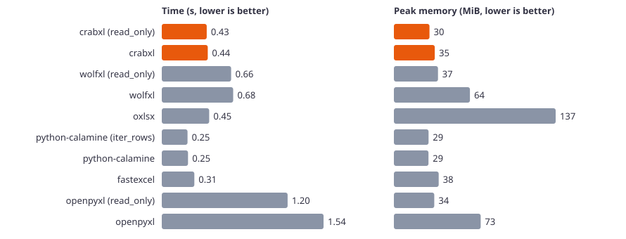
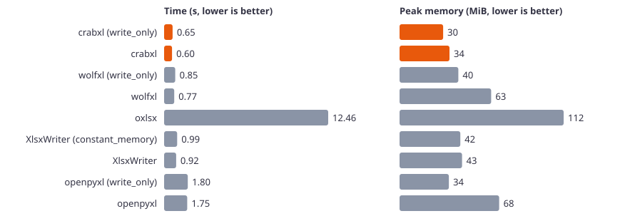
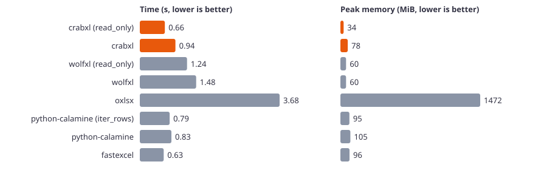
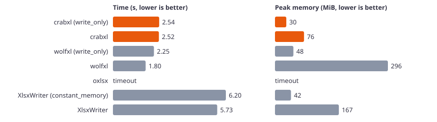
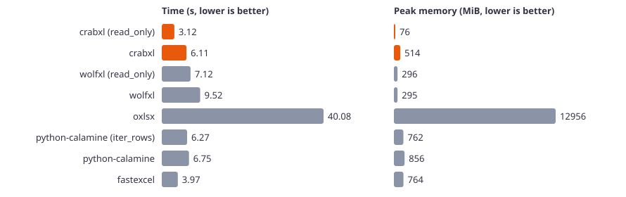
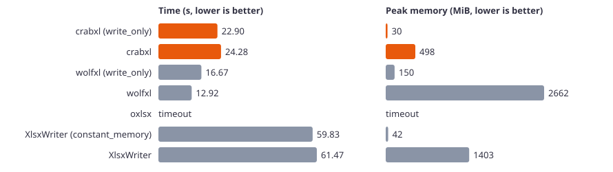

# Python benchmark results

Machine: Windows 11, AMD64 Family 25 Model 80 Stepping 0, AuthenticAMD, 12 logical CPUs. Median of 3 runs. Time is the wall time of the whole process. Memory is the peak resident memory of the process.

Python 3.13.18. crabxl 0.1.0a11, wolfxl 2.0.36, oxlsx 0.2.0, python-calamine 0.9.1, fastexcel 0.21.0, XlsxWriter 3.3.1, openpyxl 3.1.5.

## Read, small (10,000 rows × 10 columns)

| Library | Time (s) | Peak memory (MiB) |
|---|---:|---:|
| crabxl (read_only) | 0.429 | 30.0 |
| crabxl | 0.439 | 34.5 |
| wolfxl (read_only) | 0.662 | 37.2 |
| wolfxl | 0.681 | 64.2 |
| oxlsx | 0.453 | 136.6 |
| python-calamine (iter_rows) | 0.246 | 29.3 |
| python-calamine | 0.250 | 29.2 |
| fastexcel | 0.311 | 37.8 |
| openpyxl (read_only) | 1.201 | 34.1 |
| openpyxl | 1.544 | 73.3 |

## Write, small (10,000 rows × 10 columns)

| Library | Time (s) | Peak memory (MiB) |
|---|---:|---:|
| crabxl (write_only) | 0.646 | 29.8 |
| crabxl | 0.601 | 34.1 |
| wolfxl (write_only) | 0.846 | 40.2 |
| wolfxl | 0.771 | 62.6 |
| oxlsx | 12.462 | 112.2 |
| XlsxWriter (constant_memory) | 0.990 | 41.6 |
| XlsxWriter | 0.916 | 42.7 |
| openpyxl (write_only) | 1.799 | 33.7 |
| openpyxl | 1.754 | 68.1 |

## Edit, small (10,000 rows × 10 columns)

| Library | Time (s) | Peak memory (MiB) |
|---|---:|---:|
| crabxl | 0.710 | 35.2 |
| wolfxl (modify) | 1.379 | 76.3 |
| oxlsx | 0.861 | 99.1 |
| openpyxl | 2.448 | 82.4 |

## Read, medium (100,000 rows × 10 columns)

| Library | Time (s) | Peak memory (MiB) |
|---|---:|---:|
| crabxl (read_only) | 0.659 | 34.2 |
| crabxl | 0.937 | 77.7 |
| wolfxl (read_only) | 1.242 | 59.7 |
| wolfxl | 1.483 | 59.7 |
| oxlsx | 3.678 | 1472.3 |
| python-calamine (iter_rows) | 0.785 | 94.8 |
| python-calamine | 0.832 | 105.1 |
| fastexcel | 0.628 | 96.2 |

## Write, medium (100,000 rows × 10 columns)

| Library | Time (s) | Peak memory (MiB) |
|---|---:|---:|
| crabxl (write_only) | 2.540 | 29.7 |
| crabxl | 2.524 | 76.1 |
| wolfxl (write_only) | 2.250 | 48.2 |
| wolfxl | 1.797 | 295.6 |
| oxlsx | > 900 | – |
| XlsxWriter (constant_memory) | 6.202 | 41.9 |
| XlsxWriter | 5.727 | 167.2 |

## Edit, medium (100,000 rows × 10 columns)

| Library | Time (s) | Peak memory (MiB) |
|---|---:|---:|
| crabxl | 3.638 | 79.1 |
| wolfxl (modify) | 4.440 | 442.1 |
| oxlsx | 12.953 | 1262.2 |

## Read, large (1,000,000 rows × 10 columns)

| Library | Time (s) | Peak memory (MiB) |
|---|---:|---:|
| crabxl (read_only) | 3.123 | 75.9 |
| crabxl | 6.108 | 513.5 |
| wolfxl (read_only) | 7.123 | 295.6 |
| wolfxl | 9.521 | 295.1 |
| oxlsx | 40.079 | 12956.4 |
| python-calamine (iter_rows) | 6.268 | 762.5 |
| python-calamine | 6.750 | 856.5 |
| fastexcel | 3.971 | 763.7 |

## Write, large (1,000,000 rows × 10 columns)

| Library | Time (s) | Peak memory (MiB) |
|---|---:|---:|
| crabxl (write_only) | 22.903 | 29.8 |
| crabxl | 24.283 | 498.0 |
| wolfxl (write_only) | 16.666 | 149.8 |
| wolfxl | 12.915 | 2662.5 |
| oxlsx | > 900 (estimated from the smaller size) | – |
| XlsxWriter (constant_memory) | 59.830 | 41.6 |
| XlsxWriter | 61.473 | 1402.9 |

## Edit, large (1,000,000 rows × 10 columns)

| Library | Time (s) | Peak memory (MiB) |
|---|---:|---:|
| crabxl | 33.953 | 516.4 |
| wolfxl (modify) | 397.732 | 4160.3 |
| oxlsx | 142.539 | 9971.1 |
