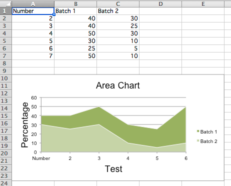
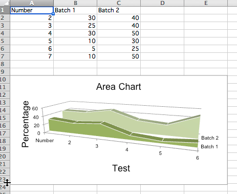

## 2D Area Charts

Area charts are similar to line charts with the addition that the area underneath the plotted line is filled.
Different variants are available by setting the grouping to "standard", "stacked" or "percentStacked"; "standard" is the default.

```python
from crabxl import Workbook
from crabxl.chart import (
    AreaChart,
    Reference,
    Series,
)

wb = Workbook()
ws = wb.active

rows = [
    ["Number", "Batch 1", "Batch 2"],
    [2, 40, 30],
    [3, 40, 25],
    [4, 50, 30],
    [5, 30, 10],
    [6, 25, 5],
    [7, 50, 10],
]

for row in rows:
    ws.append(row)

chart = AreaChart()
chart.title = "Area Chart"
chart.style = 13
chart.x_axis.title = "Test"
chart.y_axis.title = "Percentage"

cats = Reference(ws, min_col=1, min_row=1, max_row=7)
data = Reference(ws, min_col=2, min_row=1, max_col=3, max_row=7)
chart.add_data(data, titles_from_data=True)
chart.set_categories(cats)

ws.add_chart(chart, "A10")

wb.save("area.xlsx")
```



## 3D Area Charts

You can also create 3D area charts

```python
from crabxl import Workbook
from crabxl.chart import (
    AreaChart3D,
    Reference,
    Series,
)

wb = Workbook()
ws = wb.active

rows = [
    ["Number", "Batch 1", "Batch 2"],
    [2, 30, 40],
    [3, 25, 40],
    [4, 30, 50],
    [5, 10, 30],
    [6, 5, 25],
    [7, 10, 50],
]

for row in rows:
    ws.append(row)

chart = AreaChart3D()
chart.title = "Area Chart"
chart.style = 13
chart.x_axis.title = "Test"
chart.y_axis.title = "Percentage"
chart.legend = None

cats = Reference(ws, min_col=1, min_row=1, max_row=7)
data = Reference(ws, min_col=2, min_row=1, max_col=3, max_row=7)
chart.add_data(data, titles_from_data=True)
chart.set_categories(cats)

ws.add_chart(chart, "A10")

wb.save("area3D.xlsx")
```

This produces a simple 3D area chart where the third axis can be used to replace the legend:


