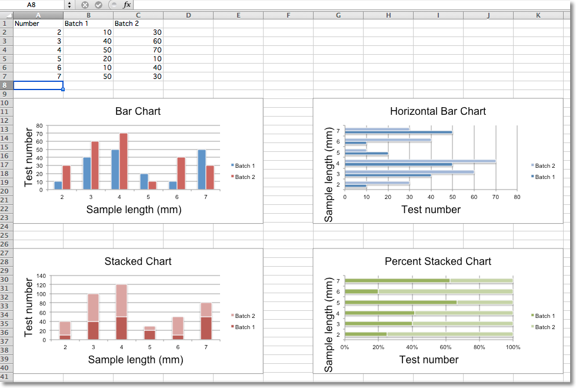
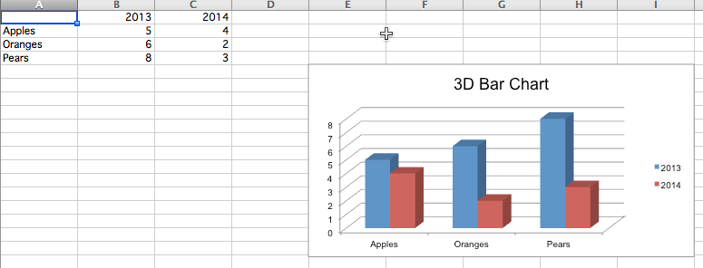

This page is adapted from the [openpyxl 3.1.5 documentation](https://openpyxl.readthedocs.io/en/3.1/) (MIT license). The calls are the same in CrabXL.

In bar charts values are plotted as either horizontal bars or vertical columns.

## Vertical, Horizontal and Stacked Bar Charts

> **Note:** 
> The following settings affect the different chart types.
>
> Switch between vertical and horizontal bar charts by setting `type` to
> `col` or `bar` respectively.
>
> When using stacked charts the `overlap` needs to be set to 100.
>
> If bars are horizontal, x and y axes are reversed.



```python
from crabxl import Workbook
from crabxl.chart import BarChart, Series, Reference

wb = Workbook(write_only=True)
ws = wb.create_sheet()

rows = [
    ("Number", "Batch 1", "Batch 2"),
    (2, 10, 30),
    (3, 40, 60),
    (4, 50, 70),
    (5, 20, 10),
    (6, 10, 40),
    (7, 50, 30),
]

for row in rows:
    ws.append(row)

chart1 = BarChart()
chart1.type = "col"
chart1.style = 10
chart1.title = "Bar Chart"
chart1.y_axis.title = "Test number"
chart1.x_axis.title = "Sample length (mm)"

data = Reference(ws, min_col=2, min_row=1, max_row=7, max_col=3)
cats = Reference(ws, min_col=1, min_row=2, max_row=7)
chart1.add_data(data, titles_from_data=True)
chart1.set_categories(cats)
chart1.shape = 4
ws.add_chart(chart1, "A10")

from copy import deepcopy

chart2 = deepcopy(chart1)
chart2.style = 11
chart2.type = "bar"
chart2.title = "Horizontal Bar Chart"

ws.add_chart(chart2, "G10")

chart3 = deepcopy(chart1)
chart3.type = "col"
chart3.style = 12
chart3.grouping = "stacked"
chart3.overlap = 100
chart3.title = "Stacked Chart"

ws.add_chart(chart3, "A27")

chart4 = deepcopy(chart1)
chart4.type = "bar"
chart4.style = 13
chart4.grouping = "percentStacked"
chart4.overlap = 100
chart4.title = "Percent Stacked Chart"

ws.add_chart(chart4, "G27")

wb.save("bar.xlsx")
```

This will produce four charts illustrating the various possibilities.

## 3D Bar Charts

You can also create 3D bar charts

```python
from crabxl import Workbook
from crabxl.chart import (
    Reference,
    Series,
    BarChart3D,
)

wb = Workbook()
ws = wb.active

rows = [(None, 2013, 2014), ("Apples", 5, 4), ("Oranges", 6, 2), ("Pears", 8, 3)]

for row in rows:
    ws.append(row)

data = Reference(ws, min_col=2, min_row=1, max_col=3, max_row=4)
titles = Reference(ws, min_col=1, min_row=2, max_row=4)
chart = BarChart3D()
chart.title = "3D Bar Chart"
chart.add_data(data=data, titles_from_data=True)
chart.set_categories(titles)

ws.add_chart(chart, "E5")
wb.save("bar3d.xlsx")
```

This produces a simple 3D bar chart


