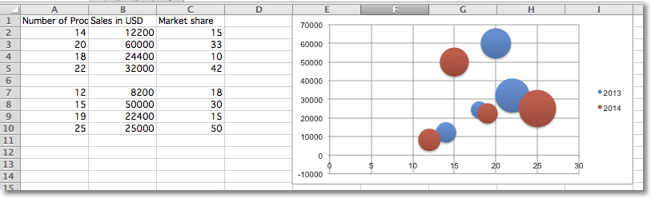

This page is adapted from the [openpyxl 3.1.5 documentation](https://openpyxl.readthedocs.io/en/3.1/) (MIT license). The calls are the same in CrabXL.

Bubble charts are similar to scatter charts but use a third dimension to determine the size of the bubbles.
Charts can include multiple series.

```python
"""
Sample bubble chart
"""

from crabxl import Workbook
from crabxl.chart import Series, Reference, BubbleChart

wb = Workbook()
ws = wb.active

rows = [
    ("Number of Products", "Sales in USD", "Market share"),
    (14, 12200, 15),
    (20, 60000, 33),
    (18, 24400, 10),
    (22, 32000, 42),
    (),
    (12, 8200, 18),
    (15, 50000, 30),
    (19, 22400, 15),
    (25, 25000, 50),
]

for row in rows:
    ws.append(row)

chart = BubbleChart()
chart.style = 18 # use a preset style

# add the first series of data
xvalues = Reference(ws, min_col=1, min_row=2, max_row=5)
yvalues = Reference(ws, min_col=2, min_row=2, max_row=5)
size = Reference(ws, min_col=3, min_row=2, max_row=5)
series = Series(values=yvalues, xvalues=xvalues, zvalues=size, title="2013")
chart.series.append(series)

# add the second
xvalues = Reference(ws, min_col=1, min_row=7, max_row=10)
yvalues = Reference(ws, min_col=2, min_row=7, max_row=10)
size = Reference(ws, min_col=3, min_row=7, max_row=10)
series = Series(values=yvalues, xvalues=xvalues, zvalues=size, title="2014")
chart.series.append(series)

# place the chart starting in cell E1
ws.add_chart(chart, "E1")
wb.save("bubble.xlsx")
```

This will produce a bubble chart with two series and should look something like this:


