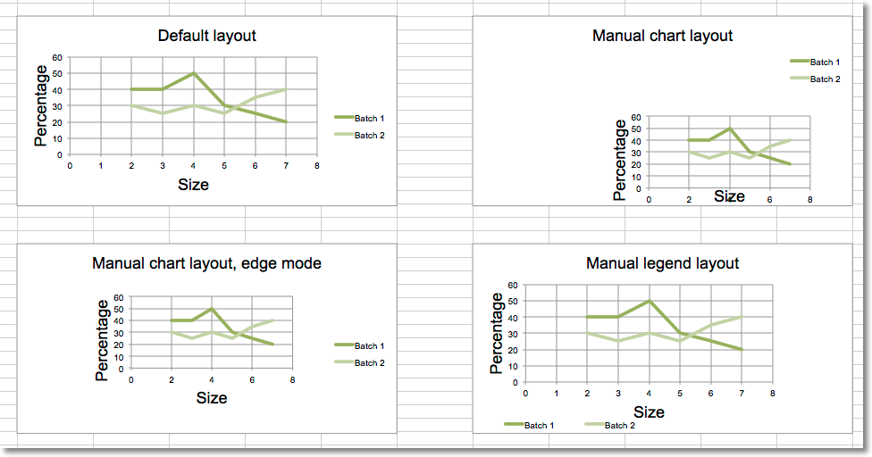

This page is adapted from the [openpyxl 3.1.5 documentation](https://openpyxl.readthedocs.io/en/3.1/) (MIT license). The calls are the same in CrabXL.

The layout of the chart within the canvas can be set by using the layout
property of an instance of a layout class.

## Chart layout

## Size and position

The chart can be positioned within its container. `x` and `y` adjust
position, `w` and `h` adjust the size . The units are proportions of the
container. A chart cannot be positioned outside of its container and the
width and height are the dominant constraints: if x + w > 1, then x = 1 - w.

| x is the horizontal position from the left
| y is the vertical position from the top
| h is the height of the chart relative to its container
| w is the width of the box

## Mode

In addition to the size and position, the mode for the relevant attribute can
also be set to either `factor` or `edge`. Factor is the default:

```python
layout.xMode = edge
```

## Target

The layoutTarget can be set to `outer` or `inner`. The default is `outer`:

```python
layout.layoutTarget = inner
```

## Legend layout

The position of the legend can be controlled either by setting its position:
`r`, `l`, `t`, `b`, and `tr`, for right, left, top, bottom and top
right respectively. The default is `r`.

```python
legend.position = 'tr'
```

or applying a manual layout:

```python
legend.layout = ManualLayout()
```

```python
from crabxl import Workbook, load_workbook
from crabxl.chart import ScatterChart, Series, Reference
from crabxl.chart.layout import Layout, ManualLayout

wb = Workbook()
ws = wb.active

rows = [
    ['Size', 'Batch 1', 'Batch 2'],
    [2, 40, 30],
    [3, 40, 25],
    [4, 50, 30],
    [5, 30, 25],
    [6, 25, 35],
    [7, 20, 40],
]

for row in rows:
    ws.append(row)

ch1 = ScatterChart()
xvalues = Reference(ws, min_col=1, min_row=2, max_row=7)
for i in range(2, 4):
    values = Reference(ws, min_col=i, min_row=1, max_row=7)
    series = Series(values, xvalues, title_from_data=True)
    ch1.series.append(series)

ch1.title = "Default layout"
ch1.style = 13
ch1.x_axis.title = 'Size'
ch1.y_axis.title = 'Percentage'
ch1.legend.position = 'r'

ws.add_chart(ch1, "B10")

from copy import deepcopy

# Half-size chart, bottom right
ch2 = deepcopy(ch1)
ch2.title = "Manual chart layout"
ch2.legend.position = "tr"
ch2.layout=Layout(
    manualLayout=ManualLayout(
        x=0.25, y=0.25,
        h=0.5, w=0.5,
    )
)
ws.add_chart(ch2, "H10")

# Half-size chart, centred
ch3 = deepcopy(ch1)
ch3.layout = Layout(
    ManualLayout(
    x=0.25, y=0.25,
    h=0.5, w=0.5,
    xMode="edge",
    yMode="edge",
    )
)
ch3.title = "Manual chart layout, edge mode"
ws.add_chart(ch3, "B27")

# Manually position the legend bottom left
ch4 = deepcopy(ch1)
ch4.title = "Manual legend layout"
ch4.legend.layout = Layout(
    manualLayout=ManualLayout(
        yMode='edge',
        xMode='edge',
        x=0, y=0.9,
        h=0.1, w=0.5
    )
)

ws.add_chart(ch4, "H27")

wb.save("chart_layout.xlsx")
```

This produces four charts illustrating various possibilities:


