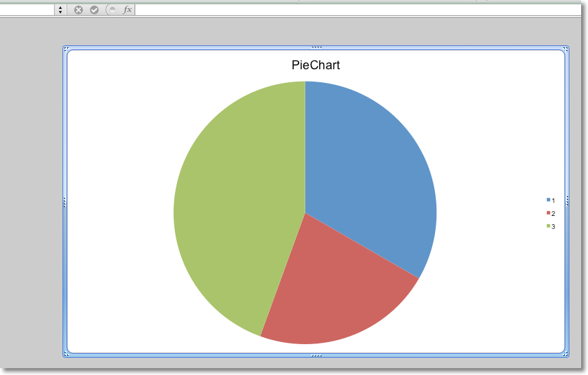

Chartsheets are special worksheets which only contain charts. All the data
for the chart must be on a different worksheet.

```python
from crabxl import Workbook

from crabxl.chart import PieChart, Reference, Series

wb = Workbook()
ws = wb.active
cs = wb.create_chartsheet()

rows = [
    ["Bob", 3],
    ["Harry", 2],
    ["James", 4],
]

for row in rows:
    ws.append(row)

chart = PieChart()
labels = Reference(ws, min_col=1, min_row=1, max_row=3)
data = Reference(ws, min_col=2, min_row=1, max_row=3)
chart.series = (Series(data),)
chart.title = "PieChart"

cs.add_chart(chart)

wb.save("demo.xlsx")
```



By default in Microsoft Excel, charts are chartsheets are designed to fit the
page format of the active printer. By default in CrabXL, charts are designed
to fit window in which they're displayed. You can flip between these using
the `zoomToFit` attribute of the active view, typically
`cs.sheetViews.sheetView[0].zoomToFit`
