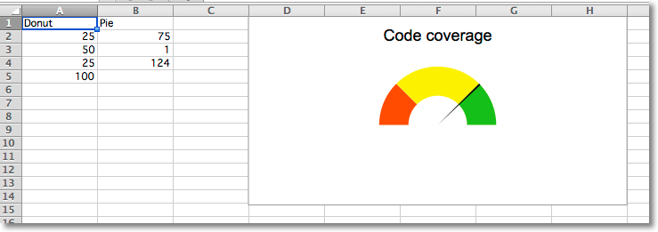

This page is adapted from the [openpyxl 3.1.5 documentation](https://openpyxl.readthedocs.io/en/3.1/) (MIT license). The calls are the same in CrabXL.

Gauge charts combine a pie chart and a doughnut chart to create a "gauge". The first chart is a doughnut chart with four slices. The first three slices correspond to the colours of the gauge; the fourth slice, which is half of the doughnut, is made invisible.

A pie chart containing three slices is added. The first and third slice are invisible so that the second slice can act as the needle on the gauge.

The effects are done using the graphical properties of individual data points in a data series.

```python
from crabxl import Workbook

from crabxl.chart import PieChart, DoughnutChart, Series, Reference
from crabxl.chart.series import DataPoint

data = [
    ["Donut", "Pie"],
    [25, 75],
    [50, 1],
    [25, 124],
    [100],
]

# based on http://www.excel-easy.com/examples/gauge-chart.html

wb = Workbook()
ws = wb.active
for row in data:
    ws.append(row)

# First chart is a doughnut chart
c1 = DoughnutChart(firstSliceAng=270, holeSize=50)
c1.title = "Code coverage"
c1.legend = None

ref = Reference(ws, min_col=1, min_row=2, max_row=5)
s1 = Series(ref, title_from_data=False)

slices = [DataPoint(idx=i) for i in range(4)]
slices[0].graphicalProperties.solidFill = "FF3300"  # red
slices[1].graphicalProperties.solidFill = "FCF305"  # yellow
slices[2].graphicalProperties.solidFill = "1FB714"  # green
slices[3].graphicalProperties.noFill = True  # invisible

s1.data_points = slices
c1.series = [s1]

# Second chart is a pie chart
c2 = PieChart(firstSliceAng=270)
c2.legend = None

ref = Reference(ws, min_col=2, min_row=2, max_col=2, max_row=4)
s2 = Series(ref, title_from_data=False)

slices = [DataPoint(idx=i) for i in range(3)]
slices[0].graphicalProperties.noFill = True  # invisible
slices[1].graphicalProperties.solidFill = "000000"  # black needle
slices[2].graphicalProperties.noFill = True  # invisible
s2.data_points = slices
c2.series = [s2]

c1 += c2  # combine charts

ws.add_chart(c1, "D1")

wb.save("gauge.xlsx")
```


