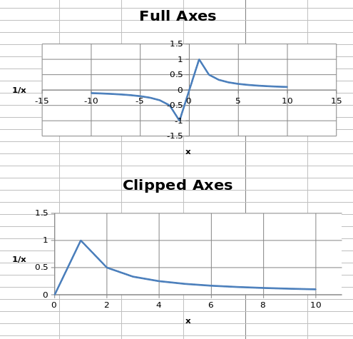
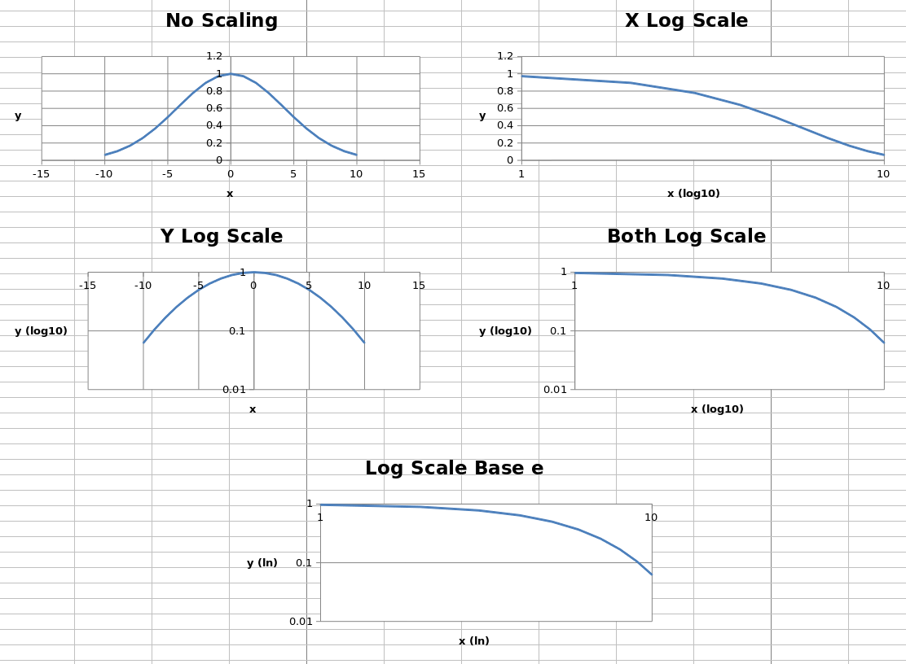
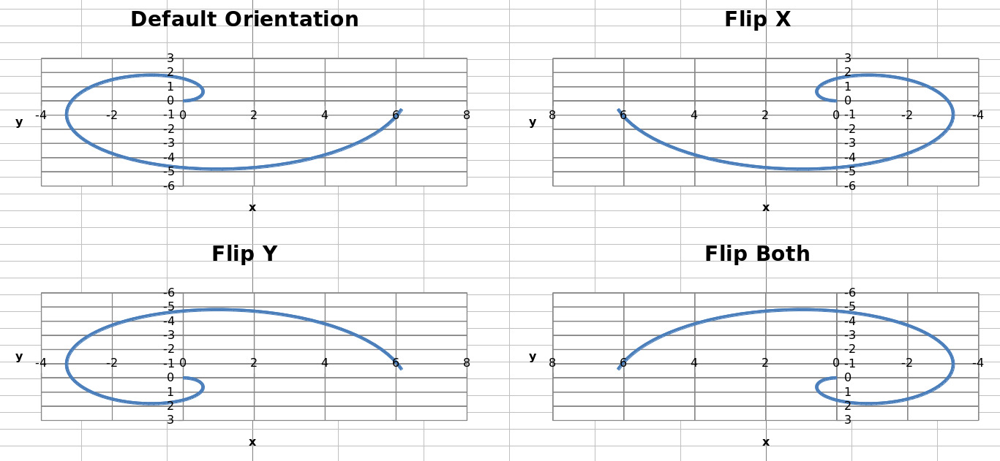

This page is adapted from the [openpyxl 3.1.5 documentation](https://openpyxl.readthedocs.io/en/3.1/) (MIT license). The calls are the same in CrabXL.

## Minima and Maxima

Axis minimum and maximum values can be set manually to display specific regions
on a chart.

```python
from crabxl import Workbook
from crabxl.chart import (
    ScatterChart,
    Reference,
    Series,
)

wb = Workbook()
ws = wb.active

ws.append(['X', '1/X'])
for x in range(-10, 11):
    if x:
        ws.append([x, 1.0 / x])

chart1 = ScatterChart()
chart1.title = "Full Axes"
chart1.x_axis.title = 'x'
chart1.y_axis.title = '1/x'
chart1.legend = None

chart2 = ScatterChart()
chart2.title = "Clipped Axes"
chart2.x_axis.title = 'x'
chart2.y_axis.title = '1/x'
chart2.legend = None

chart2.x_axis.scaling.min = 0
chart2.y_axis.scaling.min = 0
chart2.x_axis.scaling.max = 11
chart2.y_axis.scaling.max = 1.5

x = Reference(ws, min_col=1, min_row=2, max_row=22)
y = Reference(ws, min_col=2, min_row=2, max_row=22)
s = Series(y, xvalues=x)
chart1.append(s)
chart2.append(s)

ws.add_chart(chart1, "C1")
ws.add_chart(chart2, "C15")

wb.save("minmax.xlsx")
```



> **Note:** 
> In some cases such as the one shown, setting the axis limits is effectively
> equivalent to displaying a sub-range of the data. For large datasets,
> rendering of scatter plots (and possibly others) will be much faster when
> using subsets of the data rather than axis limits in both Excel and
> Open/Libre Office.

## Logarithmic Scaling

Both the x- and y-axes can be scaled logarithmically. The base of the logarithm
can be set to any valid float. If the x-axis is scaled logarithmically, negative
values in the domain will be discarded.

```python
from crabxl import Workbook
from crabxl.chart import (
    ScatterChart,
    Reference,
    Series,
)
import math

wb = Workbook()
ws = wb.active

ws.append(['X', 'Gaussian'])
for i, x in enumerate(range(-10, 11)):
    ws.append([x, "=EXP(-(($A${row}/6)^2))".format(row = i + 2)])

chart1 = ScatterChart()
chart1.title = "No Scaling"
chart1.x_axis.title = 'x'
chart1.y_axis.title = 'y'
chart1.legend = None

chart2 = ScatterChart()
chart2.title = "X Log Scale"
chart2.x_axis.title = 'x (log10)'
chart2.y_axis.title = 'y'
chart2.legend = None
chart2.x_axis.scaling.logBase = 10

chart3 = ScatterChart()
chart3.title = "Y Log Scale"
chart3.x_axis.title = 'x'
chart3.y_axis.title = 'y (log10)'
chart3.legend = None
chart3.y_axis.scaling.logBase = 10

chart4 = ScatterChart()
chart4.title = "Both Log Scale"
chart4.x_axis.title = 'x (log10)'
chart4.y_axis.title = 'y (log10)'
chart4.legend = None
chart4.x_axis.scaling.logBase = 10
chart4.y_axis.scaling.logBase = 10

chart5 = ScatterChart()
chart5.title = "Log Scale Base e"
chart5.x_axis.title = 'x (ln)'
chart5.y_axis.title = 'y (ln)'
chart5.legend = None
chart5.x_axis.scaling.logBase = math.e
chart5.y_axis.scaling.logBase = math.e

x = Reference(ws, min_col=1, min_row=2, max_row=22)
y = Reference(ws, min_col=2, min_row=2, max_row=22)
s = Series(y, xvalues=x)
chart1.append(s)
chart2.append(s)
chart3.append(s)
chart4.append(s)
chart5.append(s)

ws.add_chart(chart1, "C1")
ws.add_chart(chart2, "I1")
ws.add_chart(chart3, "C15")
ws.add_chart(chart4, "I15")
ws.add_chart(chart5, "F30")

wb.save("log.xlsx")
```

This produces five charts that look something like this:



The first four charts show the same data unscaled, scaled logarithmically in
each axis and in both axes, with the logarithm base set to 10. The final chart
shows the same data with both axes scaled, but the base of the logarithm set to
`e`.

## Axis Orientation

Axes can be displayed "normally" or in reverse. Axis orientation is controlled
by the scaling `orientation` property, which can have a value of either
`'minMax'` for normal orientation or `'maxMin'` for reversed.

```python
from crabxl import Workbook
from crabxl.chart import (
    ScatterChart,
    Reference,
    Series,
)

wb = Workbook()
ws = wb.active

ws["A1"] = "Archimedean Spiral"
ws.append(["T", "X", "Y"])
for i, t in enumerate(range(100)):
    ws.append([t / 16.0, "=$A${row}*COS($A${row})".format(row = i + 3),
                         "=$A${row}*SIN($A${row})".format(row = i + 3)])

chart1 = ScatterChart()
chart1.title = "Default Orientation"
chart1.x_axis.title = 'x'
chart1.y_axis.title = 'y'
chart1.legend = None

chart2 = ScatterChart()
chart2.title = "Flip X"
chart2.x_axis.title = 'x'
chart2.y_axis.title = 'y'
chart2.legend = None
chart2.x_axis.scaling.orientation = "maxMin"
chart2.y_axis.scaling.orientation = "minMax"

chart3 = ScatterChart()
chart3.title = "Flip Y"
chart3.x_axis.title = 'x'
chart3.y_axis.title = 'y'
chart3.legend = None
chart3.x_axis.scaling.orientation = "minMax"
chart3.y_axis.scaling.orientation = "maxMin"

chart4 = ScatterChart()
chart4.title = "Flip Both"
chart4.x_axis.title = 'x'
chart4.y_axis.title = 'y'
chart4.legend = None
chart4.x_axis.scaling.orientation = "maxMin"
chart4.y_axis.scaling.orientation = "maxMin"

x = Reference(ws, min_col=2, min_row=2, max_row=102)
y = Reference(ws, min_col=3, min_row=2, max_row=102)
s = Series(y, xvalues=x)
chart1.append(s)
chart2.append(s)
chart3.append(s)
chart4.append(s)

ws.add_chart(chart1, "D1")
ws.add_chart(chart2, "J1")
ws.add_chart(chart3, "D15")
ws.add_chart(chart4, "J15")

wb.save("orientation.xlsx")
```

This produces four charts with the axes in each possible combination of
orientations that look something like this:


