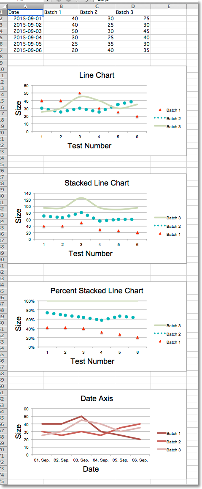
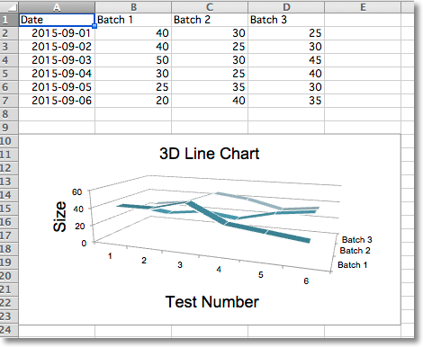

This page is adapted from the [openpyxl 3.1.5 documentation](https://openpyxl.readthedocs.io/en/3.1/) (MIT license). The calls are the same in CrabXL.

## Line Charts

Line charts allow data to be plotted against a fixed axis. They are similar
to scatter charts, the main difference is that with line charts each data
series is plotted against the same values. Different kinds of axes can be
used for the secondary axes.

Similar to bar charts there are three kinds of line charts: standard, stacked
and percentStacked.

```python
from datetime import date

from crabxl import Workbook
from crabxl.chart import (
    LineChart,
    Reference,
)
from crabxl.chart.axis import DateAxis

wb = Workbook()
ws = wb.active

rows = [
    ['Date', 'Batch 1', 'Batch 2', 'Batch 3'],
    [date(2015,9, 1), 40, 30, 25],
    [date(2015,9, 2), 40, 25, 30],
    [date(2015,9, 3), 50, 30, 45],
    [date(2015,9, 4), 30, 25, 40],
    [date(2015,9, 5), 25, 35, 30],
    [date(2015,9, 6), 20, 40, 35],
]

for row in rows:
    ws.append(row)

c1 = LineChart()
c1.title = "Line Chart"
c1.style = 13
c1.y_axis.title = 'Size'
c1.x_axis.title = 'Test Number'

data = Reference(ws, min_col=2, min_row=1, max_col=4, max_row=7)
c1.add_data(data, titles_from_data=True)

# Style the lines
s1 = c1.series[0]
s1.marker.symbol = "triangle"
s1.marker.graphicalProperties.solidFill = "FF0000" # Marker filling
s1.marker.graphicalProperties.line.solidFill = "FF0000" # Marker outline

s1.graphicalProperties.line.noFill = True

s2 = c1.series[1]
s2.graphicalProperties.line.solidFill = "00AAAA"
s2.graphicalProperties.line.dashStyle = "sysDot"
s2.graphicalProperties.line.width = 100050 # width in EMUs

s2 = c1.series[2]
s2.smooth = True # Make the line smooth

ws.add_chart(c1, "A10")

from copy import deepcopy
stacked = deepcopy(c1)
stacked.grouping = "stacked"
stacked.title = "Stacked Line Chart"
ws.add_chart(stacked, "A27")

percent_stacked = deepcopy(c1)
percent_stacked.grouping = "percentStacked"
percent_stacked.title = "Percent Stacked Line Chart"
ws.add_chart(percent_stacked, "A44")

# Chart with date axis
c2 = LineChart()
c2.title = "Date Axis"
c2.style = 12
c2.y_axis.title = "Size"
c2.y_axis.crossAx = 500
c2.x_axis = DateAxis(crossAx=100)
c2.x_axis.number_format = 'd-mmm'
c2.x_axis.majorTimeUnit = "days"
c2.x_axis.title = "Date"

c2.add_data(data, titles_from_data=True)
dates = Reference(ws, min_col=1, min_row=2, max_row=7)
c2.set_categories(dates)

ws.add_chart(c2, "A61")

wb.save("line.xlsx")
```



## 3D Line Charts

In 3D line charts the third axis is the same as the legend for the series.

```python
from datetime import date

from crabxl import Workbook
from crabxl.chart import (
    LineChart3D,
    Reference,
)
from crabxl.chart.axis import DateAxis

wb = Workbook()
ws = wb.active

rows = [
    ['Date', 'Batch 1', 'Batch 2', 'Batch 3'],
    [date(2015,9, 1), 40, 30, 25],
    [date(2015,9, 2), 40, 25, 30],
    [date(2015,9, 3), 50, 30, 45],
    [date(2015,9, 4), 30, 25, 40],
    [date(2015,9, 5), 25, 35, 30],
    [date(2015,9, 6), 20, 40, 35],
]

for row in rows:
    ws.append(row)

c1 = LineChart3D()
c1.title = "3D Line Chart"
c1.legend = None
c1.style = 15
c1.y_axis.title = 'Size'
c1.x_axis.title = 'Test Number'

data = Reference(ws, min_col=2, min_row=1, max_col=4, max_row=7)
c1.add_data(data, titles_from_data=True)

ws.add_chart(c1, "A10")

wb.save("line3D.xlsx")
```


