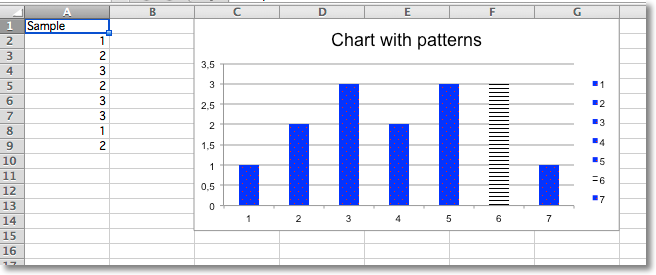

This page is adapted from the [openpyxl 3.1.5 documentation](https://openpyxl.readthedocs.io/en/3.1/) (MIT license). The calls are the same in CrabXL.

Whole data series and individual data points can be extensively styled through the `graphicalProperties`. Getting things just right may take some time.

```python
from crabxl import Workbook
from crabxl.chart import BarChart, Reference
from crabxl.chart.marker import DataPoint

from crabxl.drawing.fill import PatternFillProperties, ColorChoice

wb = Workbook()
ws = wb.active

rows = [
    ("Sample",),
    (1,),
    (2,),
    (3,),
    (2,),
    (3,),
    (3,),
    (1,),
    (2,),
]

for r in rows:
    ws.append(r)

c = BarChart()
data = Reference(ws, min_col=1, min_row=1, max_row=8)
c.add_data(data, titles_from_data=True)
c.title = "Chart with patterns"

# set a pattern for the whole series
series = c.series[0]
fill = PatternFillProperties(prst="pct5")
fill.foreground = ColorChoice(prstClr="red")
fill.background = ColorChoice(prstClr="blue")
series.graphicalProperties.pattFill = fill

# set a pattern for a 6th data point (0-indexed)
pt = DataPoint(idx=5)
pt.graphicalProperties.pattFill = PatternFillProperties(prst="ltHorz")
series.dPt.append(pt)

ws.add_chart(c, "C1")

wb.save("pattern.xlsx")
```


