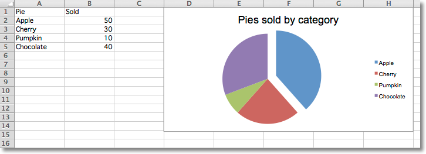
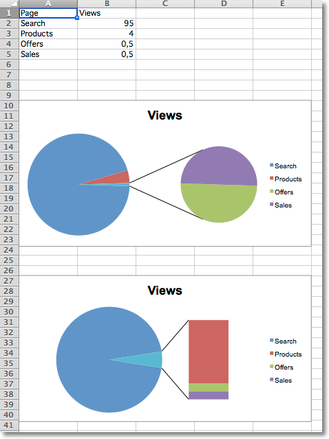
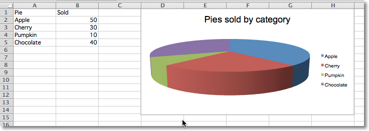
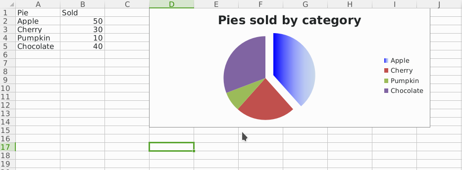

This page is adapted from the [openpyxl 3.1.5 documentation](https://openpyxl.readthedocs.io/en/3.1/) (MIT license). The calls are the same in CrabXL.

## Pie Charts

Pie charts plot data as slices of a circle with each slice representing the
percentage of the whole. Slices are plotted in a clockwise direction with 0°
being at the top of the circle. Pie charts can only take a single series of
data. The title of the chart will default to being the title of the series.

```python
from crabxl import Workbook

from crabxl.chart import PieChart, ProjectedPieChart, Reference
from crabxl.chart.series import DataPoint

data = [
    ["Pie", "Sold"],
    ["Apple", 50],
    ["Cherry", 30],
    ["Pumpkin", 10],
    ["Chocolate", 40],
]

wb = Workbook()
ws = wb.active

for row in data:
    ws.append(row)

pie = PieChart()
labels = Reference(ws, min_col=1, min_row=2, max_row=5)
data = Reference(ws, min_col=2, min_row=1, max_row=5)
pie.add_data(data, titles_from_data=True)
pie.set_categories(labels)
pie.title = "Pies sold by category"

# Cut the first slice out of the pie
slice = DataPoint(idx=0, explosion=20)
pie.series[0].data_points = [slice]

ws.add_chart(pie, "D1")

ws = wb.create_sheet(title="Projection")

data = [
    ["Page", "Views"],
    ["Search", 95],
    ["Products", 4],
    ["Offers", 0.5],
    ["Sales", 0.5],
]

for row in data:
    ws.append(row)

projected_pie = ProjectedPieChart()
projected_pie.type = "pie"
projected_pie.splitType = "val"  # split by value
labels = Reference(ws, min_col=1, min_row=2, max_row=5)
data = Reference(ws, min_col=2, min_row=1, max_row=5)
projected_pie.add_data(data, titles_from_data=True)
projected_pie.set_categories(labels)

ws.add_chart(projected_pie, "A10")

from copy import deepcopy

projected_bar = deepcopy(projected_pie)
projected_bar.type = "bar"
projected_bar.splitType = "pos"  # split by position

ws.add_chart(projected_bar, "A27")

wb.save("pie.xlsx")
```



## Projected Pie Charts

Projected pie charts extract some slices from a pie chart and project them
into a second pie or bar chart. This is useful when there are several smaller
items in the data series. The chart can be split according to percent, val(ue)
or pos(ition). If nothing is set then the application decides which to use.
In addition custom splits can be defined.



## 3D Pie Charts

Pie charts can also be created with a 3D effect.

```python
from crabxl import Workbook

from crabxl.chart import PieChart3D, Reference

data = [
    ["Pie", "Sold"],
    ["Apple", 50],
    ["Cherry", 30],
    ["Pumpkin", 10],
    ["Chocolate", 40],
]

wb = Workbook()
ws = wb.active

for row in data:
    ws.append(row)

pie = PieChart3D()
labels = Reference(ws, min_col=1, min_row=2, max_row=5)
data = Reference(ws, min_col=2, min_row=1, max_row=5)
pie.add_data(data, titles_from_data=True)
pie.set_categories(labels)
pie.title = "Pies sold by category"

ws.add_chart(pie, "D1")

wb.save("pie3D.xlsx")
```



## Gradient Pie Charts

Pie charts can also be created with gradient series.

```python
from crabxl import Workbook

from crabxl.chart import PieChart, Reference
from crabxl.chart.series import DataPoint
from crabxl.chart.shapes import GraphicalProperties
from crabxl.drawing.fill import (
    GradientFillProperties,
    GradientStop,
    LinearShadeProperties,
)
from crabxl.drawing.colors import SchemeColor

data = [
    ["Pie", "Sold"],
    ["Apple", 50],
    ["Cherry", 30],
    ["Pumpkin", 10],
    ["Chocolate", 40],
]

wb = Workbook()
ws = wb.active

for row in data:
    ws.append(row)

pie = PieChart()
labels = Reference(ws, min_col=1, min_row=2, max_row=5)
data = Reference(ws, min_col=2, min_row=1, max_row=5)
pie.add_data(data, titles_from_data=True)
pie.set_categories(labels)
pie.title = "Pies sold by category"

# Cut the first slice out of the pie and apply a gradient to it
slice = DataPoint(
    idx=0,
    explosion=20,
    spPr=GraphicalProperties(
        gradFill=GradientFillProperties(
            gsLst=(
                GradientStop(pos=0, prstClr="blue"),
                GradientStop(
                    pos=100000,
                    schemeClr=SchemeColor(val="accent1", lumMod=30000, lumOff=70000),
                ),
            )
        )
    ),
)
pie.series[0].data_points = [slice]

ws.add_chart(pie, "D1")

wb.save("pie.xlsx")
```


