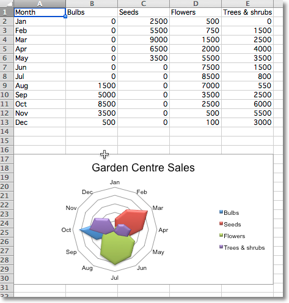

This page is adapted from the [openpyxl 3.1.5 documentation](https://openpyxl.readthedocs.io/en/3.1/) (MIT license). The calls are the same in CrabXL.

Data that is arranged in columns or rows on a worksheet can be plotted in a
radar chart. Radar charts compare the aggregate values of multiple data
series. It is effectively a projection of an area chart on a circular x-axis.

There are two types of radar chart: standard, where the area is marked with a
line; and filled, where the whole area is filled. The additional
type "marker" has no effect. If markers are desired these can be set for the
relevant series.

```python
from crabxl import Workbook
from crabxl.chart import (
    RadarChart,
    Reference,
)

wb = Workbook()
ws = wb.active

rows = [
    ["Month", "Bulbs", "Seeds", "Flowers", "Trees & shrubs"],
    [
        "Jan",
        0,
        2500,
        500,
        0,
    ],
    ["Feb", 0, 5500, 750, 1500],
    ["Mar", 0, 9000, 1500, 2500],
    ["Apr", 0, 6500, 2000, 4000],
    ["May", 0, 3500, 5500, 3500],
    ["Jun", 0, 0, 7500, 1500],
    ["Jul", 0, 0, 8500, 800],
    ["Aug", 1500, 0, 7000, 550],
    ["Sep", 5000, 0, 3500, 2500],
    ["Oct", 8500, 0, 2500, 6000],
    ["Nov", 3500, 0, 500, 5500],
    ["Dec", 500, 0, 100, 3000],
]

for row in rows:
    ws.append(row)

chart = RadarChart()
chart.type = "filled"
labels = Reference(ws, min_col=1, min_row=2, max_row=13)
data = Reference(ws, min_col=2, max_col=5, min_row=1, max_row=13)
chart.add_data(data, titles_from_data=True)
chart.set_categories(labels)
chart.style = 26
chart.title = "Garden Centre Sales"
chart.y_axis.delete = True

ws.add_chart(chart, "A17")

wb.save("radar.xlsx")
```


