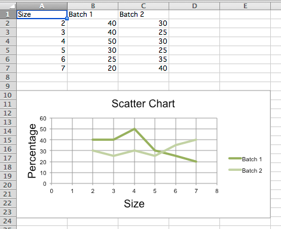

This page is adapted from the [openpyxl 3.1.5 documentation](https://openpyxl.readthedocs.io/en/3.1/) (MIT license). The calls are the same in CrabXL.

Scatter, or xy, charts are similar to some line charts. The main difference
is that one series of values is plotted against another. This is useful where
values are unordered.

```python
from crabxl import Workbook
from crabxl.chart import (
    ScatterChart,
    Reference,
    Series,
)

wb = Workbook()
ws = wb.active

rows = [
    ["Size", "Batch 1", "Batch 2"],
    [2, 40, 30],
    [3, 40, 25],
    [4, 50, 30],
    [5, 30, 25],
    [6, 25, 35],
    [7, 20, 40],
]

for row in rows:
    ws.append(row)

chart = ScatterChart()
chart.title = "Scatter Chart"
chart.style = 13
chart.x_axis.title = "Size"
chart.y_axis.title = "Percentage"

xvalues = Reference(ws, min_col=1, min_row=2, max_row=7)
for i in range(2, 4):
    values = Reference(ws, min_col=i, min_row=1, max_row=7)
    series = Series(values, xvalues, title_from_data=True)
    chart.series.append(series)

ws.add_chart(chart, "A10")

wb.save("scatter.xlsx")
```



> **Note:**
   The specification says that there are the following types of scatter charts:
   'line', 'lineMarker', 'marker', 'smooth', 'smoothMarker'. However, at least
   in Microsoft Excel, this is just a shortcut for other settings that otherwise
   have no effect. For consistency with line charts, the style for each series
   should be set manually.
