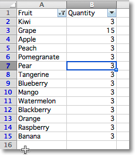

It's possible to filter single range of values in a worksheet by adding an autofilter. If you need to filter multiple ranges, you can use tables and apply a separate filter for each table.

> **Note:** 
> Filters and sorts can only be configured by CrabXL but will need to be applied in applications like Excel. This is because they actually rearrange, format and hide rows in the range.

To add a filter you define a range and then add columns. You set the range over which the filter by setting the `ref` attribute. Filters are then applied to columns in the range using a zero-based index, eg. in a range from A1:H10, colId 1 refers to column B. CrabXL does not check that the column is inside the range.

```python
from crabxl import Workbook
from crabxl.worksheet.filters import (
    FilterColumn,
    CustomFilter,
    CustomFilters,
    DateGroupItem,
    Filters,
)

wb = Workbook()
ws = wb.active

data = [
    ["Fruit", "Quantity"],
    ["Kiwi", 3],
    ["Grape", 15],
    ["Apple", 3],
    ["Peach", 3],
    ["Pomegranate", 3],
    ["Pear", 3],
    ["Tangerine", 3],
    ["Blueberry", 3],
    ["Mango", 3],
    ["Watermelon", 3],
    ["Blackberry", 3],
    ["Orange", 3],
    ["Raspberry", 3],
    ["Banana", 3],
]

for r in data:
    ws.append(r)

filters = ws.auto_filter
filters.ref = "A1:B15"
col = FilterColumn(colId=0)  # for column A
col.filters = Filters(filter=["Kiwi", "Apple", "Mango"])  # add selected values
filters.filterColumn.append(col)  # add filter to the worksheet

ws.auto_filter.add_sort_condition("B2:B15")

wb.save("filtered.xlsx")
```

This will add the relevant instructions to the file but will **neither actually filter nor sort**.



## Advanced filters

The following predefined filters can be used: `CustomFilter, DateGroupItem, DynamicFilter, ColorFilter, IconFilter and Top10` `ColorFilter, IconFilter and Top10` all interact with conditional formats.

The signature and structure of the different kinds of filter varies significantly. As such it makes sense to familiarise yourself with either the CrabXL source code or the OOXML specification.

## CustomFilter

CustomFilters can have one or two conditions which will operate either independently (the default), or combined by setting the `and_` attribute. Filter can use the following operators: `equal, lessThan, lessThanOrEqual, notEqual, greaterThanOrEqual, greaterThan`.

Filter values < 10 and > 90:

```python
from crabxl.worksheet.filters import CustomFilter, CustomFilters

flt1 = CustomFilter(operator="lessThan", val=10)
flt2 = CustomFilter(operator="greaterThan", val=90)

cfs = CustomFilters(customFilter=[flt1, flt2])
col = FilterColumn(colId=2, customFilters=cfs)  # apply to **third** column in the range
filters.filter.append(col)
```

To combine the filters:

```python
cfs.and_ = True
```

In addition, Excel has non-standardised capability for pattern matching with strings. The options in Excel: begins with, ends with, contains and their negatives are all implemented using the `equal` (or for negatives `notEqual`) operator and wildcard in the value. For this to work properly, the value is always a string.

For example: for "begins with a", is actually `a*`; for "ends with a", `*a`; and for "contains a"",  `*a*`. `?` can be used to represent a single character. In regular expressions `*` is called *greedy* and `?` *non-greedy*. Wildcards are escaped with the `~` (tilde) so that `contains ~*`is serialised as `~~~*`.

To simplify creating filters, CrabXL provides three specialised filters: `NumberFilter`; `BlankFilter` and `StringFilter`. These filters are all used only when **creating** filters. For convenience, you can use the `CustomFilter.convert()` method to convert from a CustomFilter to a more specific filter.

## NumberFilters

NumericFilters differ from CustomFilters only in that they are explicitly numerical:

```python
from crabxl.worksheet.filters import NumberFilter, CustomerFilter

flt1 = CustomFilter(operator="lessThan", val=10)
flt1.val == "10"
flt2 = NumberFilter(operator="lessThan", val=10)
flt2.val == 10.0
```

## BlankFilters

BlankFilters are used for excluding blanks and are not editable:

```python
from crabxl.worksheet.filters import BlankFilter

blank = BlankFilter()
```

## StringFilters

StringFilters have the folowing operators: `contains` `startwith` `endswith` and `wildcard`. To apply the filter in the negative, set the exclude attribue to `True`. CrabXL escapes wildcards for you:

```python
from crabxl.worksheet.filters import StringFilter

fil = StringFilter("contains", "xml", exclude=True)
```

StringFilters with the wildcard operator are the same as CustomFilters. This allows for allows for more sophisticated uses of the wildcards such as `c?n` which would match the terms `cancan` and `contains`, but not `curtains`; or `c*n` which would match all terms. CrabXL does **not** escape filters that use the wildcard operator.

> **Note:** 
> The wildcard syntax allows for even more sophisticated patterns with multiple wildcards. This capability cannot be easily expressed using StringFilters and is not a design goal.

## DateGroupItem

Date filters can be set to allow filtering by different datetime criteria such as year, month or hour. As they are similar to lists of values you can have multiple items.

To filter by the month of March:

```python
from crabxl.worksheet.filters import DateGroupItem

df1 = DateGroupItem(month=3, dateTimeGrouping="month")
col = FilterColumn(colId=1)  # second column
col.filters.dateGroupItem.append(df1)

df2 = DateGroupItem(year=1984, dateTimeGrouping="year")  # add another element
col.filters.dateGroupItem.append(df2)
filters.filter.append(col)
```
