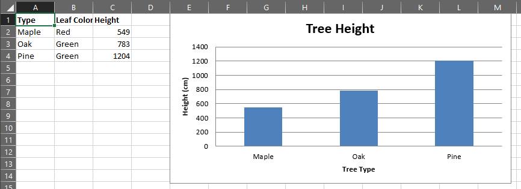

## Example: Creating a simple spreadsheet and bar chart

In this example we're going to create a sheet from scratch and add some data and then plot it.
We'll also explore some limited cell style and formatting.

The data we'll be entering on the sheet is below:

To start, let's load in CrabXL and create a new workbook. and get the active sheet.
We'll also enter our tree data.

```python
>>> from crabxl import Workbook
```

```python
>>> wb = Workbook()
>>> ws = wb.active
>>> treeData = [["Type", "Leaf Color", "Height"], ["Maple", "Red", 549], ["Oak", "Green", 783], ["Pine", "Green", 1204]]
```

Next we'll enter this data onto the worksheet. As this is a list of lists, we can simply use the `append` function.

```python
>>> for row in treeData:
...     ws.append(row)
```

Now we should make our heading Bold to make it stand out a bit more, to do that we'll need to create a `Font` and apply it to all the cells in our header row.

```python
>>> from crabxl.styles import Font
```

```python
>>> ft = Font(bold=True)
>>> for row in ws["A1:C1"]:
...     for cell in row:
...         cell.font = ft
```

It's time to make some charts. First, we'll start by importing the appropriate packages from `chart` then define some basic attributes

```python
>>> from crabxl.chart import BarChart, Series, Reference
```

```python
>>> chart = BarChart()
>>> chart.type = "col"
>>> chart.title = "Tree Height"
>>> chart.y_axis.title = 'Height (cm)'
>>> chart.x_axis.title = 'Tree Type'
>>> chart.legend = None
```

That's created the skeleton of what will be our bar chart. Now we need to add references to where the data is and pass that to the chart object

```python
>>> data = Reference(ws, min_col=3, min_row=2, max_row=4, max_col=3)
>>> categories = Reference(ws, min_col=1, min_row=2, max_row=4, max_col=1)
```

```python
>>> chart.add_data(data)
>>> chart.set_categories(categories)
```

Finally we can add it to the sheet.

```python
>>> ws.add_chart(chart, "E1")
>>> wb.save("TreeData.xlsx")
```

And there you have it. If you open that doc now it should look something like this


